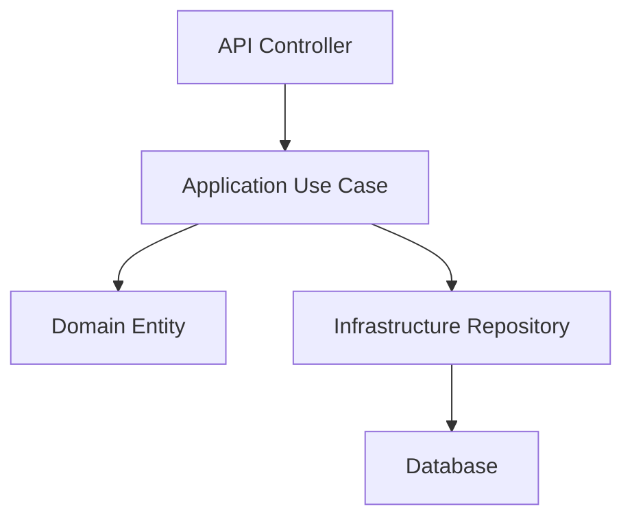

# 🌱 Ambientación del Proyecto

# Ambientacion automatica
```bash
./prod.sh
```

## 1️⃣ Instalar Poetry y 
```bash
curl -sSL https://install.python-poetry.org | python3 -
```
o brew install poetry

## 2️⃣ Agregar Poetry al PATH (si es necesario)
```bash
export PATH="$HOME/.local/bin:$PATH"
```

## 3️⃣ Verificar instalación
```bash
poetry --version
```
## 1️⃣ Instalar Pyenv
```bash
brew install pyenv
```

## 4️⃣ Instalar versión específica de Python (usando pyenv)
> Asegúrate de tener definida la versión en tu archivo `python-version`.
```bash
pyenv install
pyenv local
```

## 5️⃣ Instalar dependencias y activar entorno virtual
```bash
poetry config virtualenvs.in-project true
poetry env activate
poetry install
```

## 6️⃣ Configurar variables de entorno antes de ejecutar
> Asegúrate de tener tus variables de entorno configuradas correctamente (.env.example).

## 7️⃣ Ejecutar el entorno de desarrollo
```bash
poetry run dev
```

```text
src/
│
├── api/                # Capa de presentación: controladores y rutas de la API (entrada al sistema)
│   ├── __init__.py
│   ├── api_module.py   # Configuración y registro de rutas de la API
│   ├── task/           # Controladores relacionados con tareas
│   │   ├── __init__.py
│   │   ├── task_controller.py   # Endpoints para operaciones de tareas (crear, actualizar, listar, etc.)
│   │   └── dto/        # Data Transfer Objects para tareas
│   │       ├── create_task_dto.py      # DTO para crear tareas
│   │       ├── task_id_dto.py          # DTO para identificar tareas
│   │       ├── task_response_dto.py    # DTO para respuestas de tareas
│   │       └── update_task_dto.py      # DTO para actualizar tareas
│   └──...              # Otros controllers de la aplicación (ej. usuarios, autenticación)
│
├── application/        # Lógica de aplicación y casos de uso (orquestación de reglas de negocio)
│   ├── application_module.py   # Configuración de la capa de aplicación
│   ├── task/           # Casos de uso relacionados con tareas
│   │   ├── __init__.py
│   │   └── use_cases/  # Implementaciones de casos de uso (servicios de aplicación)
│   │       ├── __init__.py
│   │       ├── create_task_impl/   # Implementación para crear tareas
│   │       ├── get_tasks_impl/     # Implementación para obtener tareas
│   │       └── update_task_impl/   # Implementación para actualizar tareas
│   └── ...             # Otros módulos de aplicación (ej. usuarios, autenticación)
│
├── common/             # Utilidades, DTOs, excepciones y lógica compartida
│   ├── __init__.py
│   ├── core/           # Clases base y utilidades centrales (ej. patrones observador, casos de uso base)
│   │   ├── __init__.py
│   │   ├── observable_resolver.py
│   │   └── use_case.py
│   ├── dto/            # Objetos de transferencia de datos generales
│   │   ├── __init__.py
│   │   └── server_exception_serializer.py
│   └── exceptions/     # Manejo de excepciones personalizadas
│       ├── __init__.py
│       ├── codes_exception.py
│       ├── custom_server_exception.py
│       ├── generic_exception_enum.py
│       ├── messages_exception.py
│       ├── unknown_exception.py
│       └── http/       # Excepciones HTTP específicas
│
├── domain/             # Entidades, modelos y repositorios del dominio (reglas de negocio puras)
│   ├── __init__.py
│   └── task/           # Entidades y repositorios de tareas
│       ├── __init__.py
│       ├── models/         # Modelos de dominio (ej. Task)
│       ├── repositories/   # Interfaces de repositorios (abstracción de persistencia)
│       └── use_cases/      # Interfaces de casos de uso (contratos de negocio)
│
├── infraestructure/    # Implementaciones concretas (DB, frameworks, persistencia)
│   ├── __init__.py
│   ├── db/             # Conexión y lógica de base de datos
│   │   ├── __init__.py
│   │   └── db_connection.py   # Configuración y gestión de la conexión a la base de datos
│   ├── framework/      # Configuración y utilidades de frameworks externos
│   │   ├── config/         # Archivos de configuración
│   │   ├── filters/        # Filtros de petición/respuesta
│   │   ├── middleware/     # Middlewares para la API
│   │   ├── providers/      # Proveedores de dependencias
│   │   └── validators/     # Validadores de datos
│   └── persistance/    # Implementaciones de persistencia (adaptadores de repositorios)
│       ├── persistance_module.py
│       └── task/           # Persistencia específica para tareas
│
└── main.py             # Punto de entrada principal de la aplicación (inicialización y arranque)
```

---


---

## Diagrama Visual (simplificado)



